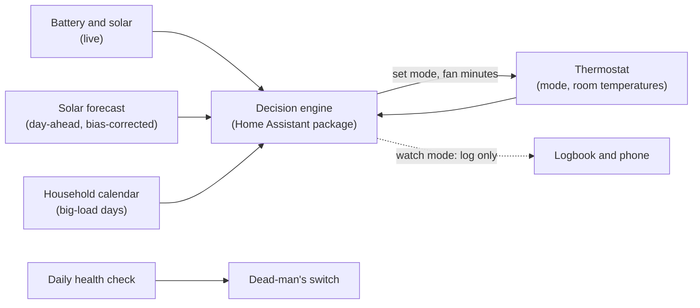

# Energy OS

An open framework for homes with solar. It answers two questions, in order: what should this house buy, and how should it run once the system is up.

Energy OS is the engine behind Home Energy Copilot. This repository holds the framework: the design method, the architecture, and a working controller you adapt to your own hardware.

## Two kinds of savings

1. **Design.** Proposals are sized to a sales target. Energy OS sizes to your worst month, prices panels per usable kWh, and tests every proposal against nine questions. The result: a smaller system to buy.
2. **Operation.** Solar pays most when the house uses what it makes. Energy OS shifts heating, cooling and fan runtime into your production hours and picks the cheaper fuel. The result: a shorter payback.

## The three layers

| Layer | Job | In this repo |
|---|---|---|
| Design | Decide what to buy | [`docs/design-method.md`](docs/design-method.md) |
| Operate | Run the house on its own | [`config/energy_os.yaml`](config/energy_os.yaml), [`docs/decision-logic.md`](docs/decision-logic.md) |
| Watch | Prove it is still working | [`config/energy_os_health.yaml`](config/energy_os_health.yaml), [`docs/safe-rollout.md`](docs/safe-rollout.md) |

How the layers fit together: [`docs/framework.md`](docs/framework.md).

## How the operate layer works

Each morning the engine decides whether the day can run on solar. It sets a forecast, corrected by what your roof actually produced, against what the house will need. Through the day it moves between gas heat, heat pump, cool and off, inside hard safety limits.

## Quick start

1. Read [`docs/adapting-to-your-home.md`](docs/adapting-to-your-home.md). It lists every placeholder entity you map to your own hardware.
2. Copy `config/energy_os.yaml` and `config/energy_os_health.yaml` into your Home Assistant `packages` folder.
3. Leave watch mode on. The controller logs what it would do and sends no command.
4. Run it for a week against real days. Turn watch mode off only when the log matches what you would have done by hand.

## Status

1. Operate: built, and run on one home in watch mode.
2. Other hardware: mapping designed and documented, not yet tested on another home.
3. Design: a documented method today, a guided tool in Home Energy Copilot.
4. Data: every entity id and number in the repo is a placeholder or an example. Set yours from your own meter.

Roadmap: [`docs/roadmap.md`](docs/roadmap.md). Design reasoning: [`docs/engineering-decisions.md`](docs/engineering-decisions.md). What a Heat press does on a dual-fuel home: [`docs/fuel-pre-selection.md`](docs/fuel-pre-selection.md).

## Safety

Energy OS can switch heating and cooling. It ships in watch mode, keeps a hard battery floor on every path, backs off when you change the thermostat by hand, and has a master off switch. Read [`docs/safe-rollout.md`](docs/safe-rollout.md) before you turn watch mode off.

## License

MIT. No warranty.
