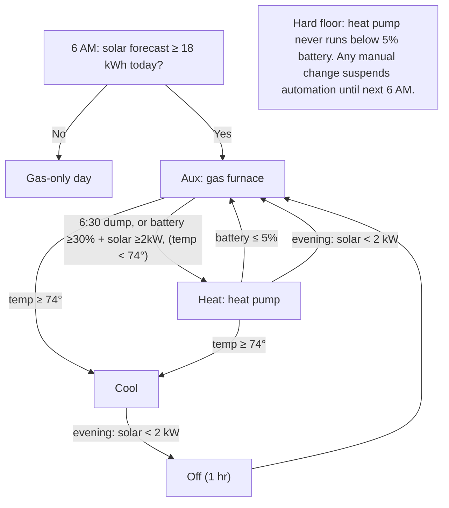
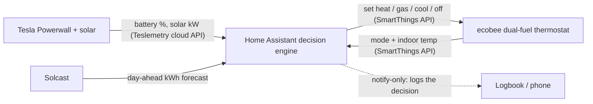

# Solar-Optimized Dual-Fuel HVAC Controller

A home automation that picks the lowest-cost way to automatically heat or cool the house (electric heat pump,
gas furnace, AC, or off) from how much solar is being produced right now, how full the home
battery is, the day's solar forecast, and the household's preferences. The automation has the potential
to save thousands of dollars over a year, over and above the selecting optimal electric/gas utility plan, 
optimally configuring Ecobee Premium Thermostats with temperature and stagic logic, and selecting the optimal
time-of-use or self-powered modes in the Tesla app. This system can be easily extended to EV charging. 

It runs on Home Assistant, drives an ecobee thermostat, and reads a Tesla Powerwall and a solar forecast.
The control logic is not trivial. It is a multi-mode state machine that balances live battery
charge, live solar, a day-ahead forecast, indoor temperature, and manual overrides, with safety
floors and a manual-override hold. The payoff is financial: chasing self-consumption at this
resolution is worth on the order of thousands of dollars a year versus the stock thermostat
schedule and the settings the Tesla app exposes on its own.

Background note: I built this for my own house but I want to make it freely accessible.
The repo is organized around the design reasoning and the constraints I worked through, written up
in [`docs/engineering-decisions.md`](docs/engineering-decisions.md).

## The problem

My house has a dual-fuel heating system, an electric heat pump and a gas furnace, plus rooftop
solar and a Tesla Powerwall. On a sunny day, running the heat pump off my own solar and battery is
nearly free. When the sun is down or the battery is empty, gas costs less than pulling heat-pump
power off the grid. The thermostat does not know any of this; it switches on outdoor temperature.
So I was switching between heat, gas, cool, and off by hand 4 to 5 times a day to follow my own
solar. The goal was to automate that.

## The insight

The decision is not really about temperature. It is "use the lowest-cost energy source available
given the current solar surplus." That becomes a daily pattern: dump the overnight battery into the
heat pump as the sun comes up, let gas cover the midday gap while solar refills the battery, run the
heat pump on the afternoon solar surplus, then hand back to gas for the night, and skip electric
heat entirely on low-sun days when there is no surplus to harvest.

## How it works

Full state machine, thresholds, and reasoning: [`docs/system-design.md`](docs/system-design.md).

## Architecture

- Reads: battery and solar from the Powerwall via Teslemetry; the day's forecast from Solcast;
  thermostat mode and indoor temperature from the ecobee.
- Control: through the SmartThings API (raw REST), because ecobee's own developer API is closed to
  new keys, and SmartThings is the only path that can command the gas furnace (auxiliary heat) on a
  dual-fuel system.
- It runs in Home Assistant on a spare PC. No custom app: every integration already existed, so a
  custom app would mean rebuilding all of it plus a 24/7 backend.

## Design notes

A few of the decisions that took the most thought (full write-ups in
[`docs/engineering-decisions.md`](docs/engineering-decisions.md)):

- Prove the make-or-break unknown first. Before writing logic, I confirmed with a live API call
  that physically fired the furnace that the gas mode could be set programmatically.
- A blocker that became a simplification. Local Powerwall reads are gated behind a password sealed
  in the unit on current firmware; moving to the official cloud API removed the blocker and a
  hardware constraint with it.
- A capability ceiling, handled cleanly. The fan-runtime control I wanted is not exposed by the API
  I am on, so I documented the limit, deferred it, and drafted a request for the native API rather
  than shipping an approximation.
- Accuracy where it changes the decision. When the solar forecast read high, I traced it to a
  configuration convention rather than a forecasting flaw, and noted it only matters near the
  decision threshold, so I logged it to tune later.

## Status

Running in a notify-only shakedown: it evaluates the full logic against live sensor data and logs
the action it would take without touching the thermostat, so the logic can be validated over
several days before it controls anything. Roadmap and known limitations:
[`docs/roadmap.md`](docs/roadmap.md).

## Repo map

| Path | What's in it |
|---|---|
| `docs/system-design.md` | The decision logic as a precise state machine: thresholds, transitions, failsafes |
| `docs/engineering-decisions.md` | The design decisions and the constraints behind them |
| `docs/architecture.md` | Why each tool, the data flow, the build order |
| `docs/roadmap.md` | Known limitations and what is next |
| `docs/diagrams/` | Mermaid source for the flowchart and architecture |
| `docs/setup/` | How it was built and verified (control test, local-read test, day-0 install) |
| `docs/native-api-request.md` | The closed-API workaround and the access request behind it |
| `config/solar_hvac.yaml` | The implementation: the Home Assistant package |
| `config/secrets.example.yaml` | The secret structure (no secrets committed) |

## Tech

Home Assistant (YAML automations and REST), Tesla Powerwall via Teslemetry, ecobee via the
SmartThings API, Solcast PV forecast. Diagrams in Mermaid.

Personal, non-commercial project. Entity IDs, device IDs, and address are replaced with
placeholders; adapt the `config/` files to your own hardware before use.
