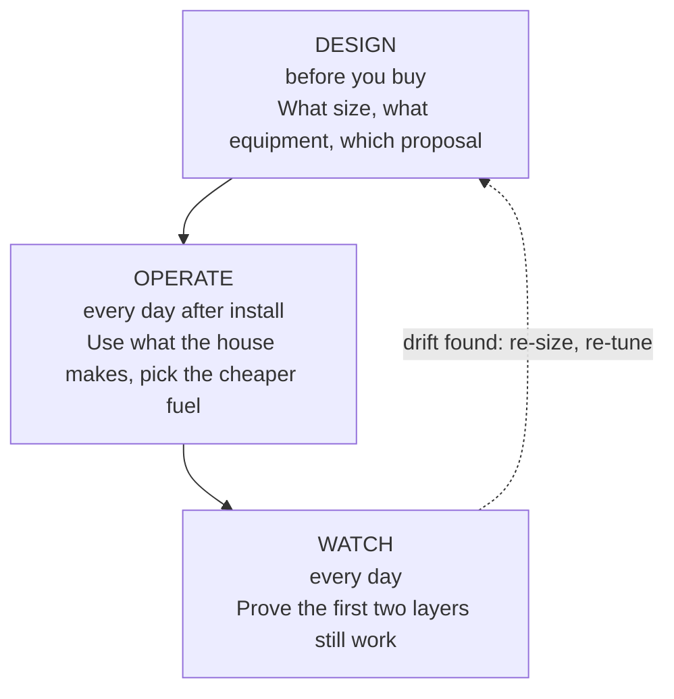

# The Energy OS framework

Energy OS treats a home with solar as one system with one goal: the lowest energy spend at full comfort. Three layers pursue it, each at its own time.

## Layer 1: Design

The buyer faces proposals built to sell. Design replaces the sales view with the house's own numbers.

1. Collect what installers ask for once, plus what they do not ask: how people live in the house.
2. Model production against use month by month and hour by hour.
3. Size to the worst month. Extra panels add cost, not savings.
4. Test every proposal against the nine questions in [`design-method.md`](design-method.md).
5. Model planned changes before buying: a heat pump, a furnace swap, an EV.

Output: a size, an equipment list, a price per usable kWh, and a list of claims to question.

## Layer 2: Operate

Once the system exists, savings depend on when the house uses energy. Operate moves flexible load to the hours the house produces.

1. Inputs: battery charge, live solar, a day-ahead forecast, the household calendar, thermostat state.
2. A daily gate decides whether the day can run on solar at all.
3. A state machine moves between gas heat, heat pump, cool and off. See [`decision-logic.md`](decision-logic.md).
4. The forecast is corrected by what the roof really produced. The correction is learned every night.
5. Safety limits apply on every path. See [`safe-rollout.md`](safe-rollout.md).

Output: a thermostat that follows the sun without anyone touching it.

## Layer 3: Watch

An automatic system fails quietly. Watch makes failure loud.

1. A daily check confirms the automations are loaded and on, the thermostat answers, the forecast is fresh, and the learned correction is not stuck.
2. A pass sends a ping to a dead-man's-switch service. A silent day means an alert, even if Home Assistant itself is down.
3. A failure raises a notification on the phone.

Output: a short message each day that says "OK", or says what broke.

## Principles

1. **Prove the unknown first.** Test the one thing that could end the project before building anything on it.
2. **Start in watch mode.** Log the decision before taking it.
3. **Humans win.** Any manual change to the thermostat suspends the automation.
4. **Treat every input as a claim.** A forecast, a rate table and a proposal each carry someone else's assumptions. Check where yours differ.
5. **Learn from the roof.** Replace the forecast's assumptions with measured results.
6. **Reuse what exists.** Use mature integrations for hardware. Write only the decision logic.

## From framework to product

The framework is generic. The product, Home Energy Copilot, fills it in per home.

| Framework piece | In the product |
|---|---|
| Design method | A guided intake and a proposal checker |
| Entity mapping | An automatic scan of the home's devices |
| Tunable numbers | Starting values from the home's own bills and meter data |
| Watch layer | A hosted health page and alerts |
